# 용어먹는하마 — 온디바이스 AI 채점 IT 용어 앱

뜻을 **직접 입력**하고, **복수정답**을 인정하고, 애매한 답은 "비슷했어요"로 알려주는
오프라인 암기 앱.

한국어 의미 판정을 위해 **임베딩 모델을 기기에 탑재**했다.
서버도, 로그인도, 네트워크 연결도 필요 없다.

React Native (Expo prebuild) · TypeScript · ONNX Runtime

> 이름은 단기기억을 관장하는 **해마**(hippocampus)에서 Hippo 를 따왔다.
> IT 용어를 먹어 치우는 하마라는 뜻이다.

<sub>최종 수정 2026-11-17 · 2026-09-18 시작 · [변경 이력](#변경-이력)</sub>

---

## 화면

| 런칭 | 시작 — 범위를 고른다 | 목록 — 전체를 훑어본다 |
|---|---|---|
| 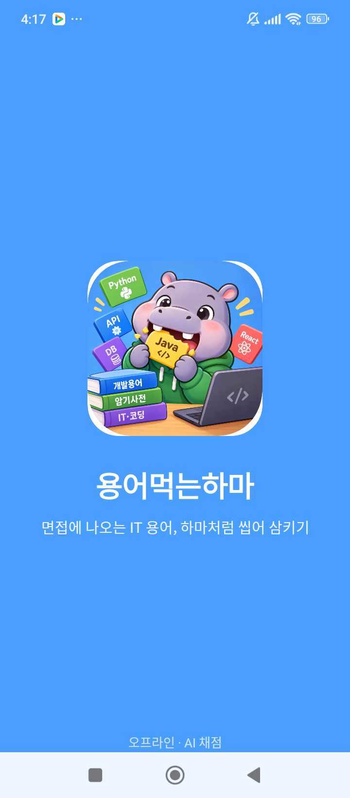 | 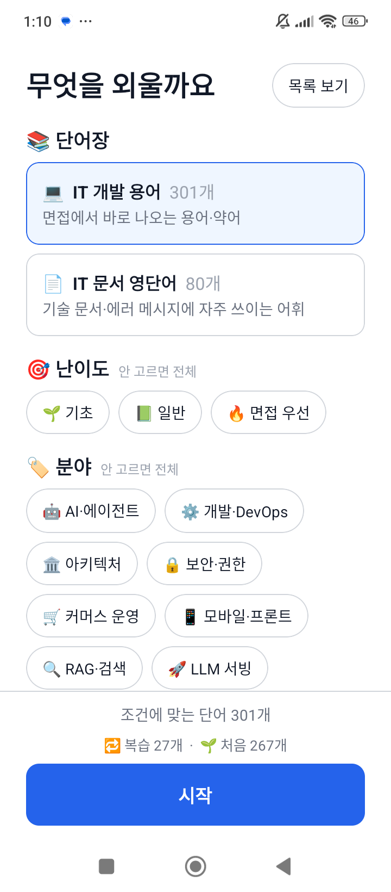 | 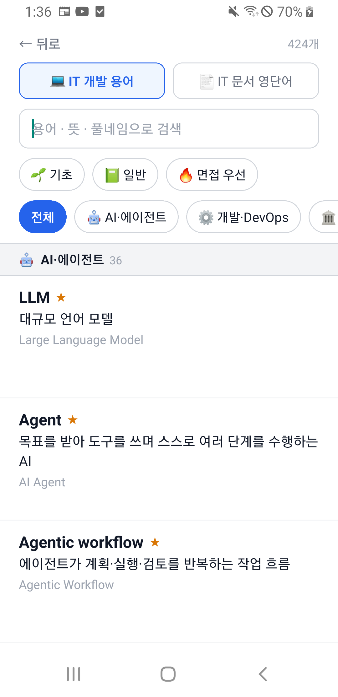 |
| 이 동안 임베딩 모델을 올린다.<br>주관식이 있는 덱에서는<br>**AI 채점 준비됨**으로 뜬다 | 단어장·난이도·분야·방식·문항 수.<br>아래에 **🔁 복습 / 🌱 처음** 개수가<br>범위에 맞춰 계속 보인다 | 분야별로 묶이고 헤더가 고정된다.<br>★는 면접 우선 등급 |

| 객관식 — 헷갈리는 것끼리 묶어 낸다 | 채점 |
|---|---|
| 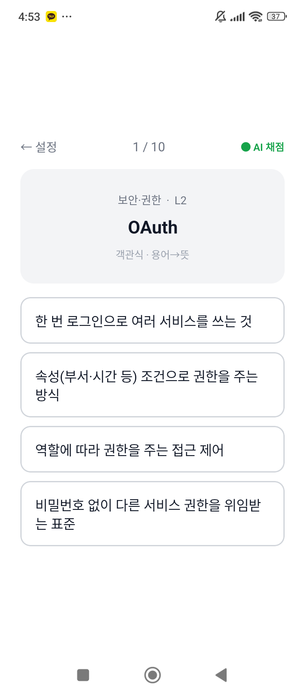 | 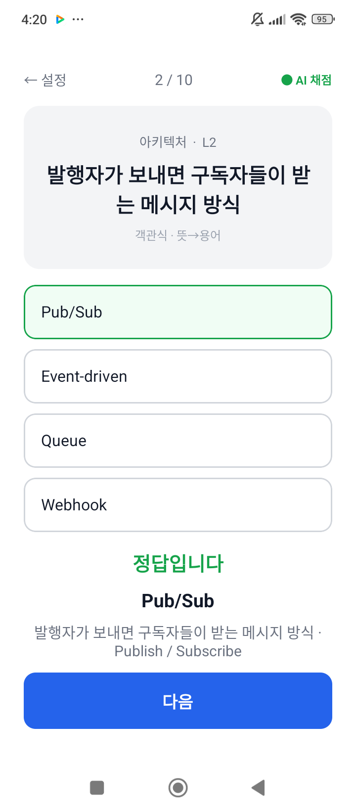 |
| `PII`의 오답 보기가 **인가·JWT·HITL**.<br>같은 분야에서 실제로 헷갈리는 용어들이다 | `Pub/Sub`의 오답 보기는<br>**Event-driven·Queue·Webhook**.<br>정답은 초록, 풀네임도 함께 보여준다 |

| 오답 | 모르면 넘긴다 |
|---|---|
| 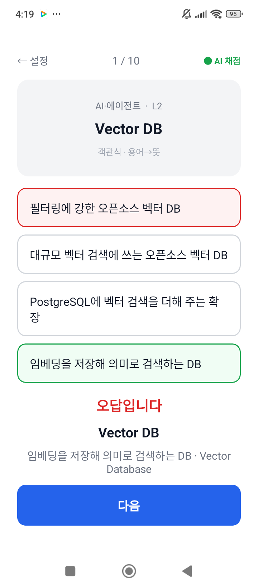 | 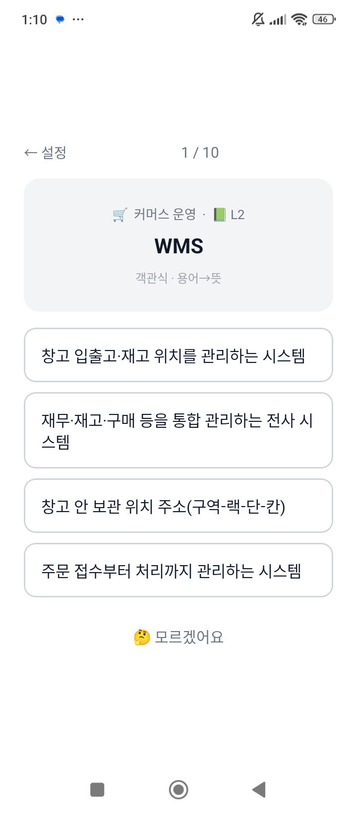 |
| `Vector DB`의 보기가 전부 벡터 DB 설명이다.<br>내가 고른 것은 빨강, 정답은 초록 | 찍으면 25%로 맞고, 맞으면 간격이 늘어<br>**모르는 단어가 안 나오게 된다**.<br>**🤔 모르겠어요**는 내일 다시 꺼낸다 |

| 결과 · 오답노트 | 터치하면 펼쳐진다 |
|---|---|
| 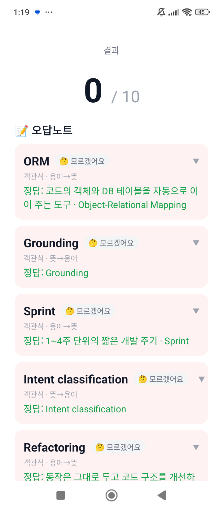 | 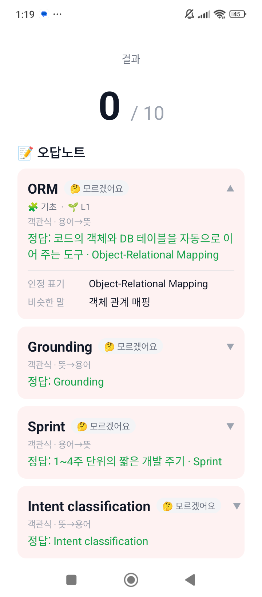 |
| 정답은 **물어본 방향으로** 보여준다.<br>`뜻→용어`면 뜻이 아니라 **용어**가 정답란에 | 분야·난이도와 인정 표기, 비슷한 말,<br>헷갈리는 것까지. 틀린 걸 다시 볼 때<br>제일 필요한 자리다 |

### 주관식 채점 — 직접 입력했을 때

| 복수정답 인정 | "비슷했어요" | AI 활용형 판정 |
|---|---|---|
| 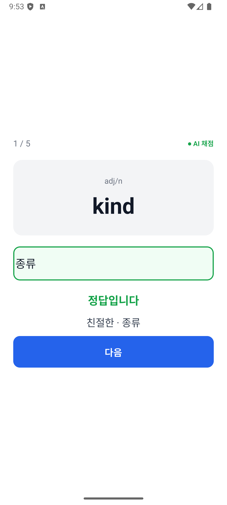 | 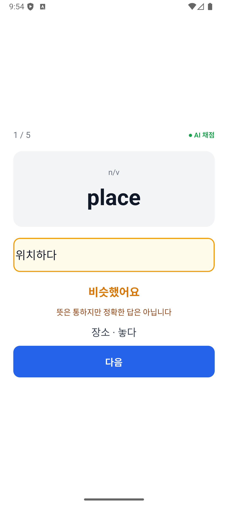 | 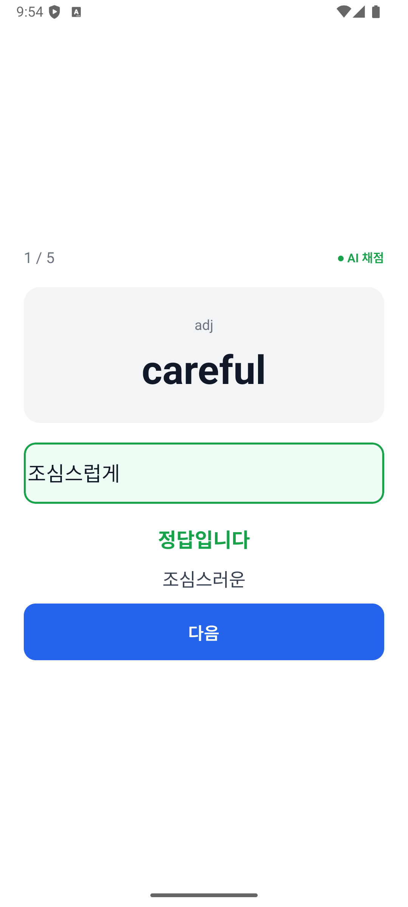 |
| `kind`의 두 번째 뜻<br>**"종류"**도 정답 | `place` → **"위치하다"**는<br>오답이되 통한다고 알려준다 | `careful` → **"조심스럽게"**.<br>규칙으로는 못 잡는다 (0.92) |

> 주관식은 **IT 문서 영단어** 덱에서만 쓴다. IT 용어 덱은 뜻이 서술형이라
> 받아쓰기가 성립하지 않아 객관식만 낸다 (위 '출제 방식' 참조).
> 기본 단어장은 **IT 개발 용어**다.

---

## 단어장

| 단어장 | 수록 | 구성 |
|---|---|---|
| **IT 개발 용어** | 424개 | AI·에이전트 / 개발·DevOps / 아키텍처 / 보안·권한 / 커머스 운영 /<br>모바일·프론트 / RAG·검색 / LLM 서빙 / 대화형 AI / 컨택센터 /<br>제조·스마트팩토리 / 물류 현장 / Vision AI / 기간계 연동 / SI·프로젝트 /<br>쿠버네티스·인프라 / LLM 게이트웨이 / 문서 AI·LangGraph /<br>빌드·패키지 / 타입 계약 / 서버 상태·스트림 / LLM 평가 / 기초 |
| **IT 문서 영단어** | 80개 | 문서 읽기 / 에러·로그 / 리뷰·협업 / 릴리스·운영 |

용어는 한국어 뜻과 영문 풀네임을 함께 담는다. 둘 다 정답으로 인정한다.

```json
{
  "word": "RAG",
  "meanings": ["검색한 자료를 근거로 답을 생성하는 방식",
               "Retrieval-Augmented Generation"],
  "partOfSpeech": "AI·에이전트",
  "near": ["검색 증강 생성"],
  "level": 3,
  "aliases": ["RAG", "Retrieval-Augmented Generation"],
  "confusable": ["Fine-tuning", "Grounding", "Embedding"]
}
```

| 필드 | 쓰임 |
|---|---|
| `meanings` | 정답으로 인정할 뜻 (배열) |
| `near` | "비슷했어요"로 처리할 근접 오답 |
| `aliases` | 뜻→용어 방향에서 인정할 다른 표기 (`sLLM`, `경량 LLM`, …) |
| `confusable` | 객관식 오답 보기의 1순위 후보 — 헷갈리는 용어끼리 묶는다 |
| `level` | 1 기초 / 2 일반 / 3 면접 우선 |

JSON은 손으로 고치지 않는다. `data/build_it_terms.py`가 생성하며,
별칭 충돌·중복 뜻·헷갈림 묶음 누락을 생성 시점에 검사한다.

---

## 사용법

1. **단어장**을 고르고 **난이도·분야**로 범위를 좁힌다 (안 고르면 전체)
2. **출제 방식**을 고른다 — 덱이 지원하는 방식만 보인다
3. **문항 수**(10 / 20 / 30)를 고르고 시작
4. 보기에서 고르거나(객관식) 직접 입력한다(주관식)
   - 초록 **정답입니다**
   - 주황 **비슷했어요** — 뜻은 통하지만 정확하지 않음 (점수 없음)
   - 빨강 **오답입니다**
   - 모르면 **🤔 모르겠어요** — 찍지 말고 넘긴다. 내일 다시 나온다
5. 끝나면 **결과와 오답노트**가 나온다. 항목을 **터치하면 펼쳐진다**

> 주관식이 있는 덱에서는 우상단 **● AI 채점** 표시가 초록이면 모델이
> 준비된 상태다. 모델 로딩(약 2초)은 런칭 화면이 가려 주므로 보통은
> 준비된 채로 시작한다. 로딩이 늦어도 규칙 기반 채점으로 쓸 수 있다.
>
> 저사양 기기에서 106MB 모델 로딩이 실패하면 **○ 규칙 채점**으로 바뀐다.
> "로딩 중"으로 남겨 두면 끝나지 않는 로딩처럼 읽히는데, 실제로는 규칙
> 기반(어간·`near` 목록)으로 정상 동작하는 상태다.

### 출제 방식 — 덱마다 다르다

| 방식 | 묻는 것 | IT 개발 용어 | IT 문서 영단어 |
|---|---|:---:|:---:|
| 객관식 · 용어→뜻 | 보기 4개 중 고르기 | ✅ | ✅ |
| 객관식 · 뜻→용어 | 보기 4개 중 고르기 | ✅ | ✅ |
| 주관식 · 용어→뜻 | `deprecated` → ? | — | ✅ |
| 주관식 · 뜻→용어 | `더 이상 권장되지 않는` → ? | — | ✅ |

**뜻→용어** 방향을 따로 둔 이유: 용어를 보면 아는데 막상 말로 설명할 때
떠오르지 않는 경우가 있다. 양방향으로 물어야 실제로 외웠는지 확인된다.

| IT 개발 용어 — 객관식만 | IT 문서 영단어 — 넷 전부 |
|---|---|
| 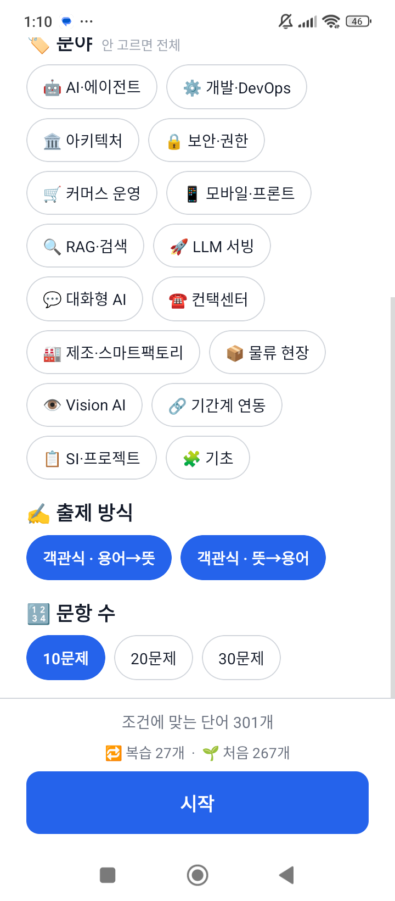 | 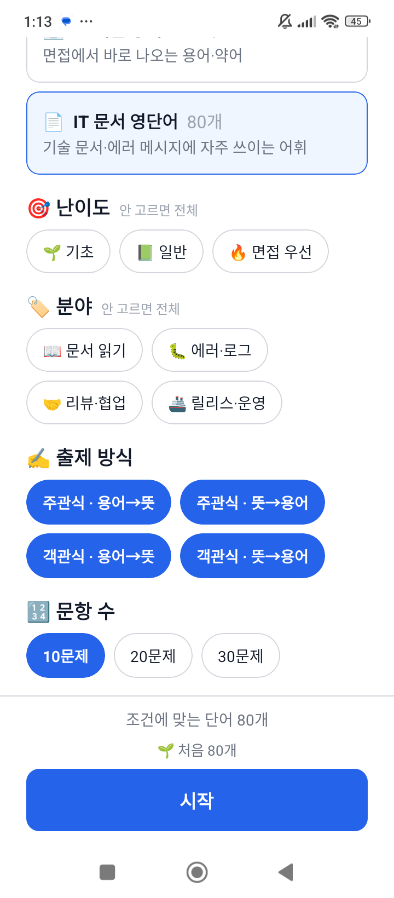 |

**IT 용어 덱에 주관식이 없는 이유**는 뜻이 서술형 문장이라서다. 424개의
첫 번째 뜻이 중간값 24자, 15자 이상이 95%, 최대 45자다.

```
FDE → "고객 현장에 들어가 제품을 맞춰 붙이고 요구를 개발팀에 전달하는 엔지니어"
```

받아쓸 수 있는 길이가 아니다. 뜻을 **알아도** 자기 말로 짧게 쓰게 되고,
그러면 유사도가 정답선을 못 넘어 오답이 된다 — 아는데 틀리는 구조다.
영단어 덱은 뜻이 짧고(10자 이하가 56%) 80개 전부 유의어를 들고 있어서
표현이 달라도 데이터로 잡힌다. 그래서 거기서는 주관식을 유지한다.
([#9](https://github.com/reddol18/dev_keyword_test/issues/9))

### 목록 보기

시작 화면 우상단에서 전체 용어를 훑어볼 수 있다.
분야별로 묶여 있고 헤더가 상단에 고정되며, ★는 면접 우선 등급이다.
덱·난이도·분야를 바꾸면 맨 위로 돌아가고, 424개를 끝까지 내려도
멈추지 않는다 ([#15](https://github.com/reddol18/dev_keyword_test/issues/15)).

검색은 용어뿐 아니라 **뜻·풀네임·근접어**까지 훑고, 일부만 쳐도 걸린다.
`Reprodu` 까지만 쳐도 `Reproducibility` 가 나온다.

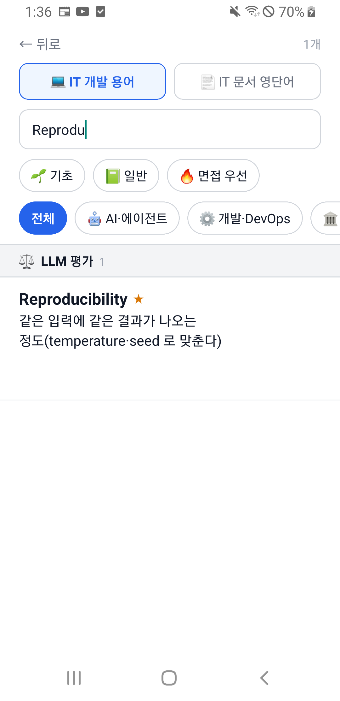

찾는 단어가 **다른 덱**에 있으면 그쪽을 알려 준다.
덱이 424 대 80 으로 기울어 있어 영단어 덱 80개는 존재가 잊히기 쉽고,
그래서 "있던 게 없어졌다"로 읽힌다 — 실제로 그렇게 제보를 받았다.
([#14](https://github.com/reddol18/dev_keyword_test/issues/14))

| 없다고만 하지 않는다 | 검색어를 들고 넘어간다 |
|---|---|
| 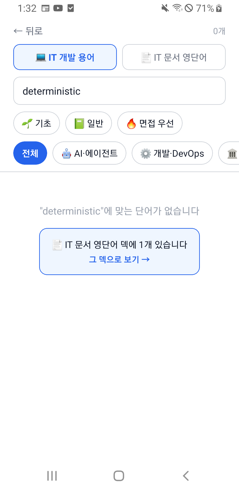 | 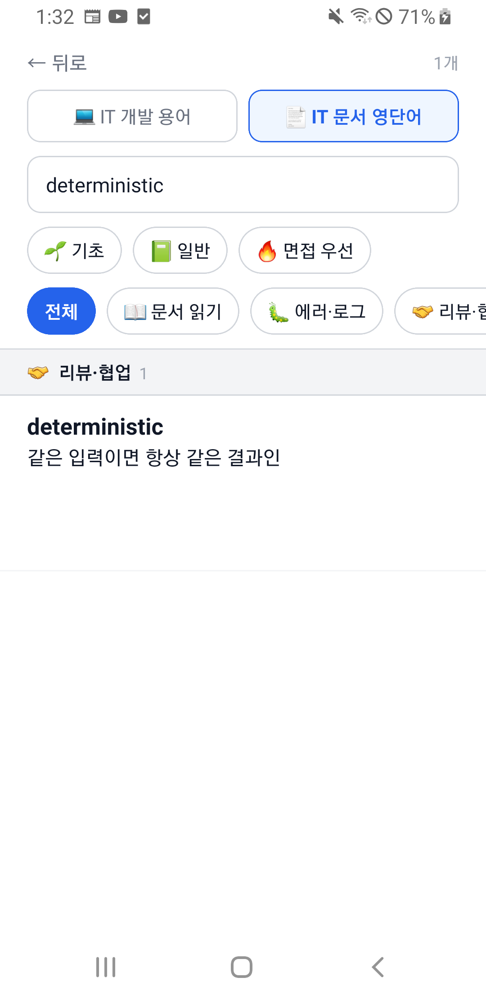 |
| `deterministic`은 **영단어 덱**에 있다.<br>거기 몇 개 있는지까지 세어 보여준다 | 누르면 덱이 바뀌고 **검색어는 그대로**.<br>찾던 단어가 바로 보인다 |

### 잊을 때쯤 다시 나온다 — 간격 반복

단어마다 **다음에 보여줄 날짜**를 들고 있다. 맞히면 간격이 길어지고 틀리면 하루로 돌아간다.

```
맞힘        streak +1,  간격 = 1 · 3 · 7 · 14 · 30 · 60일 (streak 번째)
비슷했어요   streak  0,  간격 = 2일
틀림        streak  0,  간격 = 1일
```

출제 순서는 이렇다.

| 순위 | 대상 |
|---|---|
| 1 | **오늘 틀린 것** — 바로 다시 본다 |
| 2 | **복습할 때가 된 것** — 밀린 것부터 |
| 3 | **처음 보는 것** |
| 4 | 나머지 |

**처음 보는 단어 자리를 매 회차 2개 떼어 둔다.** 우선순위만 따르면 복습이 자리를
다 차지해서, 덱을 하루 10문제로 90일 돌려도 23%밖에 못 본다. 두 자리를 비워 두면
63%가 된다 (301개였을 때 재 본 값 — 69개 → 191개). 면접 대비라 덱을 한 바퀴
도는 것도 중요하다. 덱이 424개로 늘었으니 한 바퀴에 걸리는 날은 그만큼 길어진다.

오늘 **맞힌** 단어는 그날 다시 나오지 않는다. 다만 **틀린** 단어는 같은 날에도
다시 나온다 — 오답을 바로 복습하는 흐름이 끊기지 않게.

기록은 기기에만 남는다(`AsyncStorage`, 키 `srs-v2`). 목록 화면 맨 아래에
**진도 내보내기**가 있다 — 저장된 카드 전체를 아래 저장 모양 그대로(버전 포함)
JSON 으로 만들어 공유 시트로 넘긴다. 같은 자리에 **처음부터 다시 외우기**(확인
다이얼로그를 거친다)와 "이 기기에만 저장된다"는 안내를 함께 뒀다. 안드로이드
자동 백업(`allowBackup`)이 켜져 있어 기기를 바꾸면 구글 계정 백업으로 복원되지만,
그건 사용자가 직접 제어할 수 없으므로 내보내기를 따로 둔다. 가져오기는 아직 없다.

저장 모양은 이렇다. **덱마다 따로 기록한다** — 두 덱에 겹치는 단어가 있어서
(`Rollback`/`rollback`, `Incident`, `Postmortem`, `Legacy`) 단어만 키로 쓰면
한쪽에서 맞힌 게 다른 쪽 진도로 새어 간다. 덱이 늘면 겹침도 늘어난다.

```jsonc
{
  "version": 2,
  "cards": {
    "it-terms:Rollback": { "streak": 2, "due": "2026-11-23", "last": "2026-11-16" },
    "it-words:rollback": { "streak": 0, "due": "2026-11-17", "last": "2026-11-16" }
  }
}
```

**버전을 데이터 안에 넣어 둔다.** 키 이름에만 있으면 읽는 쪽이 모양을 확인할
수단이 없어서, `Card` 에 필드를 하나 추가하는 순간 기존 기록이 `undefined` 인
채로 통과하고 `due` 비교가 전부 어긋나 복습이 조용히 멈춘다. 예외도 로그도
없이 멈추는 종류라 재설치 말고는 복구 경로가 없다.

옛 `srs-v1`(덱 구분 없는 평면 구조)은 첫 실행에 한 번 옮긴다. 단어가 실제로
어느 덱에 있는지 찾아서 귀속시키고, 옮긴 뒤 옛 키를 지운다. 실패하면 옛 키를
남겨 두고 다음 실행에 다시 시도한다 — 마이그레이션이 학습을 막지는 않는다.

---

## 왜 만들었나

기존 단어장 앱 리뷰를 읽고 시작했다. 학생들의 불만이 구체적이었다.

- "영단어만 보고 **뜻 직접 쓰는 것**도 있었으면"
- "문제들이 다 순서대로 나와요 **랜덤으로** 나왔으면"
- "**복수정답도 되게** 좀 해주세요 … 진짜 스트레스 받아요"
- "단어쓰기 할때 **대문자로 계속 시작해서** 불편해요"
- "**인터넷 연결없이도** 학습할 수 있으면"

객관식이 아니라 직접 입력, 그리고 **맞는 답을 틀렸다고 하지 않는 것**이 핵심이었다.

---

## 채점이 어떻게 동작하나

한국어 뜻 채점은 생각보다 까다롭다. "여행하다"를 정답으로 두면
학생이 쓴 "여행가다"는? "조심스러운"에 대해 "조심스럽게"는?

### 3단계 판정

```
정답        점수 O   초록
비슷했어요   점수 X   주황  ← 뜻은 통하지만 정확하지 않음
오답        점수 X   빨강
```

### 판정 순서

규칙과 모델을 **조합**한다. 어느 하나만으로는 부족했다.

**1. 어간 일치 → 정답**

어미를 떼고 비교한다. `여행하다` `여행가다` `여행` → 모두 `여행`.

모델보다 이쪽이 확실한 경우가 있다. `연습하다`↔`연습`을 모델은 0.45로
떨어뜨리지만 같은 말이다.

**2. 유의어 목록 → 비슷했어요**

데이터에 명시한 근접 오답. `place`의 `near: ["위치하다", "두다", ...]`.

모델이 `위치하다`↔`두다`를 0.33으로 보기 때문에 이것도 필요하다.

**3. 임베딩 유사도**

위에서 안 걸리면 모델이 판정한다.

```
유사도 ≥ 0.85  →  정답
유사도 ≥ 0.70  →  비슷했어요
그 미만        →  오답
```

### 임계값을 0.85로 높게 잡은 이유

실측해보니 **이 모델은 반의어를 잘 구분하지 못한다.**

```
기억하다 ↔ 잊다       0.6520   ← 반대말인데 높다
빌려주다 ↔ 빌리다     0.6966   ← 반대말인데 높다
어려운   ↔ 쉬운       0.6005
연습하다 ↔ 연습       0.4470   ← 같은 말인데 낮다
위치하다 ↔ 두다       0.3321   ← 유의어인데 낮다
```

임베딩 모델의 알려진 한계다. 반의어는 같은 문맥에 등장하므로 벡터가 가깝다.

그래서 **모델은 활용형 판정에만 쓰고**(거기선 확실히 강하다), 나머지는
규칙과 데이터에 맡겼다.

```
조심스럽게 ↔ 조심스러운   0.9224   ← 규칙으로는 못 잡던 것
친절한     ↔ 친절하다     0.9232
여행가다   ↔ 여행하다     0.8798
```

### 용어는 표기를 느슨하게 본다

IT 용어는 띄어쓰기·하이픈 표기가 제각각이다. 뜻→용어 방향에서는
`[\s\-_/.]`를 모두 떼고 비교한다. `Pub/Sub` `PubSub` `pub sub`이 같게 취급된다.

### 객관식 오답 보기는 어떻게 고르나

우선순위대로 고른다.

1. `confusable`에 묶인 용어 — `Hybrid search` ↔ `BM25` ↔ `Reranker`
2. 같은 분야에서 글자가 비슷한 것
3. 같은 난이도
4. 무작위

**정답과 겹치는 보기는 반드시 걸러낸다.** 보기 후보가 정답의
`meanings`·`aliases`·`near` 중 무엇과도 겹치면 제외한다. 안 그러면
"정답이 2개인" 문제가 나온다.

여기서는 임베딩을 쓰지 않는다. 문제마다 모델을 돌리면 수십 ms가 더 붙는데,
오답 보기는 "그럴듯하면" 충분해서 글자 유사도(자소 Jaccard)로 족하다.

---

## 왜 온디바이스인가

리뷰에 "인터넷 연결 없이도 학습하고 싶다"가 있었다. 그리고

- **서버 비용 0** — 유지비가 들지 않는다
- **응답 40~80ms** — API 왕복보다 빠르다
- **개인정보 없음** — 입력이 기기 밖으로 나가지 않는다

### 실측 (Redmi Note 14 Pro, arm64)

| 항목 | 값 |
|---|---|
| 모델 로딩 | 2.1초 (앱 시작 시 1회) |
| 추론 | 40~80ms / 문항 |
| 모델 크기 | 106MB (int8 양자화) · APK 안에서는 86.9MB |

폰에서 나온 유사도 값이 PC에서 파이썬으로 계산한 값과
**소수점 4자리까지 일치**했다. int8 양자화가 ARM에서 정확히 동작한다는 뜻이다.

---

## 기술 스택

| 영역 | 선택 | 비고 |
|---|---|---|
| 프레임워크 | React Native 0.86 (Expo 57 prebuild) | 네이티브 모듈을 쓰려고 prebuild |
| 언어 | TypeScript | strict |
| 추론 | `onnxruntime-react-native` 1.24.3 | JSI 기반, 기기 CPU |
| 모델 | [`jhgan/ko-sroberta-multitask`](https://huggingface.co/jhgan/ko-sroberta-multitask) | 한국어 SBERT, int8 |
| 토크나이저 | `@huggingface/tokenizers` | 순수 JS, 97KB |
| 저장 | 로컬 JSON + `AsyncStorage` | 백엔드 없음 |

---

## 실행 방법

### 준비

```sh
npm install                  # postinstall이 onnxruntime 패치를 적용한다
./scripts-fetch-model.sh     # 모델 106MB 다운로드 (저장소에 없음)
npx expo prebuild --platform android
```

`android/`는 저장소에 두지 않는다. `prebuild`로 생성하면
`scripts-postinstall.js`가 적용한 패치가 그대로 반영된다.

### 개발 모드

```sh
npx expo start --dev-client
```

별도 터미널에서:
```sh
npm run android
```

### 단독 실행 APK

```sh
cd android && ./gradlew assembleRelease
adb install android/app/build/outputs/apk/release/app-release.apk
```

JS 번들과 모델이 APK에 포함되어 **네트워크 없이 단독 실행**된다. 181MB.

ARM 기기용으로만 빌드한다 (`arm64-v8a`, `armeabi-v7a`). x86 계열을 넣으면
106.8MB 가 더 붙는데 실기기에서 쓰이지 않는다. 설정은 `app.json` 의
`expo-build-properties` → `buildArchs` 에 있다 — `android/gradle.properties`
를 직접 고치면 `expo prebuild` 가 덮어쓴다.

> 개발 빌드(`assembleDebug`)는 Metro 서버가 있어야 실행된다.
> 오프라인 동작을 확인하려면 release로 빌드할 것.

### 구글 플레이 업로드용 AAB

플레이 스토어는 APK 를 받지 않는다. `.aab`(Android App Bundle)로 올린다.

```sh
cd android && ./gradlew bundleRelease
# → android/app/build/outputs/bundle/release/app-release.aab
```

서명이 제대로 들어갔는지는 인증서 주체로 확인한다.

```sh
keytool -printcert -jarfile android/app/build/outputs/bundle/release/app-release.aab
```

`CN=Android Debug` 가 나오면 **잘못된 것이다.** debug 키로 서명된
AAB 는 플레이가 거부한다.

---

## 릴리스 서명

### prebuild 가 서명을 지우는 문제

Expo 가 만드는 `android/app/build.gradle` 은 release 빌드도 debug 키로
서명한다. 템플릿에 경고까지 박혀 있다.

```gradle
release {
    // Caution! In production, you need to generate your own keystore file.
    signingConfig signingConfigs.debug
```

그런데 `android/` 는 저장소에 두지 않고 `expo prebuild` 로 생성한다.
**`build.gradle` 을 손으로 고치면 다음 prebuild 에서 사라진다.**
한 번 올리고 끝이면 모르겠지만, 의존성을 하나 추가할 때마다 서명이
조용히 debug 로 되돌아가는 건 사고다. 빌드는 성공하고, 거부는
업로드할 때 알게 된다.

`expo-build-properties` 에 서명 옵션이 있으면 그걸 썼겠지만
[v57 옵션 목록](https://docs.expo.dev/versions/v57.0.0/sdk/build-properties/)에
없다. `buildArchs`·`minSdkVersion`·`extraProguardRules` 류뿐이다.

그래서 **prebuild 파이프라인 안에** 끼워 넣었다 —
`plugins/withReleaseSigning.js` 가 config plugin 으로 돌면서
`signingConfigs.release` 를 추가하고 `buildTypes.release` 를 그쪽으로
돌린다. prebuild 가 네이티브 파일을 만든 직후에 실행되므로, 몇 번을
다시 만들어도 끝에서 항상 같은 수정이 다시 적용된다.
`--clean` 을 붙여도 살아남는다.

### 비밀번호는 어디에 있나

`build.gradle` 에 박지 않는다. 생성물이라 실수로 커밋될 여지가 있고,
이 저장소는 공개다. 값의 출처는 `.env` 한 곳이다 (AdMob ID 와 같은 자리).

```
ANDROID_KEYSTORE_FILE=keystore/release.keystore
ANDROID_KEYSTORE_PASSWORD=...
ANDROID_KEY_ALIAS=...
ANDROID_KEY_PASSWORD=...
```

플러그인이 이 값을 읽어 `android/gradle.properties` 로 옮기고,
`build.gradle` 은 속성 이름만 참조한다. `.env` 가 없는 환경
(저장소를 clone 한 남의 PC, CI)에서는 아무것도 하지 않고 debug 서명을
그대로 둔다 — 서명 키가 없다고 빌드가 깨지는 쪽이 더 불편하다.

### ★ 키스토어 백업 — 잃으면 복구가 안 된다

키스토어는 `keystore/release.keystore` 에 있고 **git 에 올라가지 않는다**
(`.gitignore` 의 `/keystore/`, `*.keystore`).

구글 플레이는 **앱의 신원을 이 키로 확인한다.** 잃어버리면:

- 그 앱에 **업데이트를 영구히 올릴 수 없다.** 비밀번호 재발급 같은 건 없다
- 새 키로 새 앱을 올리는 수밖에 없다 — 패키지명도, 설치 수도, 리뷰도 전부 처음부터
- 유출되면 남이 내 앱 이름으로 업데이트를 배포할 수 있다

유효기간은 2050년 이후까지(`-validity 10000`) 잡아 뒀다. 플레이 권장이다.

**지금 해 둘 일** — `keystore/release.keystore` 와 `.env` 를 함께:

1. **이 PC 밖**으로 복사한다. 외장 디스크나 USB 하나, 개인 클라우드 하나
   (최소 두 곳. 한 곳은 물리적으로 다른 장소)
2. 비밀번호는 키스토어와 **다른 곳**에 둔다 — 비밀번호 관리자가 제일 낫다.
   같은 폴더에 메모로 넣으면 백업이 통째로 유출될 때 같이 넘어간다
3. 압축해서 암호를 거는 방법도 괜찮다. 단 그 암호도 어딘가 남겨야 한다

> 플레이 콘솔의 **Play App Signing** 을 켜면 구글이 배포용 서명 키를
> 따로 보관해 주지만, 여기 있는 **업로드 키는 여전히 내 책임**이다.
> 업로드 키를 잃으면 구글에 재설정을 요청할 수는 있다 — 백업보다 느리고
> 번거롭다.

---

## 테스트

```bash
npm test              # jest (146개)
npm test -- --watch   # 고친 파일만 다시
npm run typecheck     # tsc --noEmit
```

`jest-expo` 프리셋을 쓴다. **화면 렌더링은 테스트하지 않는다** — 순수 함수만
본다. RN 컴포넌트를 띄우는 설정 비용이 크고, 이 앱에서 조용히 깨지는 건
화면이 아니라 채점·출제 로직이다.

`src/*.test.ts` 4개 파일, [GitHub Actions](.github/workflows/test.yml) 에서
push·PR 마다 `tsc --noEmit` 과 함께 돌린다.

| 파일 | 지키는 것 |
|---|---|
| `grading.test.ts` | `stem()` 이 **긴 어미를 먼저** 떼는지. `ENDINGS` 순서가 뒤집히면 `여행하다` → `여행하` 가 되어 `여행` 과 어긋나고 복수정답 인정이 깨진다. `gradeTerm()` 이 **SLA ↔ SLO** 를 서로 정답으로 받지 않는지 |
| `srs.test.ts` | `nextCard()` 의 간격이 `INTERVALS`(1·3·7·14·30·60) 를 따르는지. **깨진 기록이 들어와도 `due` 가 NaN 날짜가 되지 않는지**. `priorityOf()` 의 4분기 |
| `quiz.test.ts` | **`choices[answerIndex]` 가 항상 기대 정답인지** — 어긋나면 "정답이 보기에 없음" 또는 "보기 둘 다 정답"이 된다. 중복 없이 N개, `MIN_NEW` 가 새 단어 자리를 확보하는지 |
| `data.test.ts` | 단어 JSON 품질 — 뜻 1개 이상, 덱 내 `word` 중복 0, 첫 뜻 중복 0(객관식 정답이 둘이 된다), `partOfSpeech` 빈 값 없음. `build_it_terms.py` 가 생성 시점에 `assert` 로 지키는 규칙을 CI 에서도 지킨다 |

### 테스트가 실제로 뭘 잡는지 확인했다

"통과하지만 아무것도 검증하지 않는 테스트"가 가장 나쁘다. 그래서 일부러
세 군데를 깨 보고 **그 테스트들만** 빨개지는지 봤다.

| 일부러 넣은 회귀 | 결과 |
|---|---|
| `ENDINGS` 순서를 뒤집었다 | `stem` 5개 실패 |
| `nextCard` 의 streak 가드를 뺐다 | NaN 가드 5개 실패 (`due` 가 `NaN-NaN-NaN`) |
| `buildChoices` 의 `answerIndex` 를 `0` 으로 고정했다 | 정답 위치 4개 실패 |

14개가 실패하고 89개는 통과했다. 로직을 안 건드리는 `data.test.ts` 는
그대로 초록이었다 — 테스트가 **자기 대상만** 보고 있다는 뜻이다. 확인 후 되돌렸다.

### 네이티브 모듈은 가짜로 바꾼다

순수 함수만 보는데도 그 함수가 든 파일이 네이티브 모듈을 import 한다
(`grading.ts` → `embedding.ts` → ONNX, `srs.ts` → AsyncStorage).
import 시점에 바인딩을 찾아서 Node 에서는 바로 터지므로 `jest.setup.js` 에서
둘만 막는다. **채점 로직 자체는 실제 코드를 쓴다.**

모델은 로딩하지 않아 `isModelReady()` 가 false 로 남는다. 그래서 채점이
규칙 기반 경로(어간·`near`)만 타고, 테스트 결과가 모델 유사도에 흔들리지 않는다.

---

## 프로젝트 구조

```
src/
  SplashScreen.tsx  런칭 화면 (네이티브 스플래시 뒤를 이어받는다)
  StartScreen.tsx   단어장·난이도·분야·방식·문항 수 선택
  QuizScreen.tsx    시험 화면
  ResultScreen.tsx  결과 · 오답노트
  ListScreen.tsx    전체 목록 훑어보기 · 검색
  quiz.ts           출제 (간격 반복 순서)
  choices.ts        객관식 오답 보기 생성
  grading.ts        3단계 채점 (어간 → 유의어 → 모델)
  srs.ts            간격 반복 — 다음에 볼 날짜 (AsyncStorage)
  decks.ts          단어장 정의 · 필터
  embedding.ts      ONNX 추론 · 토크나이저 · 코사인 유사도
  theme.ts          공통 스타일
  types.ts          Word, Grade, QuizMode, Question, Answer
  *.test.ts         순수 함수 테스트 4개 (→ 테스트)
jest.setup.js       네이티브 모듈(ONNX·AsyncStorage) 가짜로 바꾸기
data/
  it_terms.json     IT 개발 용어 424개   ← build_it_terms.py 가 생성
  it_words.json     IT 문서 영단어 80개  ← build_it_words.py 가 생성
  quiz_cli.mjs      채점·출제 로직 CLI 점검용
assets/model/
  model.onnx        임베딩 모델 (git 제외, 스크립트로 받음)
  tokenizer.json
plugins/
  withReleaseSigning.js  릴리스 서명을 prebuild 후에도 유지 (→ 릴리스 서명)
keystore/
  release.keystore  업로드 키 (git 제외 — 백업 필수)
```

---

## 빌드 중 만난 문제

`onnxruntime-react-native`를 Expo prebuild 환경에 붙일 때 두 가지에 막혔다.
둘 다 `scripts-postinstall.js`에서 자동 처리한다.

### 1. `unimodule.json` — 조용히 실패하는 자동링킹

패키지에 `unimodule.json`이 들어 있어 `expo-modules-autolinking`이
**Expo 모듈로 오인**한다. 그래서 RN 커뮤니티 자동링킹에서 제외되는데,
실제로는 Expo 모듈이 아니라 **어느 쪽에도 등록되지 않는다.**

빌드는 성공한다. 실행하면 `Cannot read property 'install' of null`로 죽는다.
빌드 로그에 아무 단서가 없다.

파일을 지우면 정상 등록된다.
([관련 이슈](https://github.com/microsoft/onnxruntime/issues/29004))

### 2. 단어만 고치면 APK 에 반영되지 않는다

`data/*.json` 만 고치고 빌드하면 **`BUILD SUCCESSFUL` 이 떠도 APK 안에는
옛 단어가 그대로 들어간다.** Gradle 이 이 JSON 을 JS 번들 태스크의 입력으로
추적하지 않아 "변경 없음"으로 보고 번들 생성을 건너뛰기 때문이다.

빌드가 비정상적으로 빨리 끝나면(1분 내외) 이것을 의심할 것. 확인은
APK 안의 번들을 직접 열어 보는 게 확실하다.

```sh
tar -xf app-release.apk assets/index.android.bundle
```

> **번들은 Hermes 바이트코드라 평문 `grep` 이 안 된다.** 문자열이 테이블에
> 따로 들어가는데, **ASCII 전용 문자열은 1바이트(latin1), 한글이 섞이면
> UTF-16LE** 로 저장된다. 둘 다 찾아야 한다. 한쪽만 보면 멀쩡히 들어간
> 데이터를 "없다"고 읽는다 — 실제로 `WMS` 를 대조군으로 넣고서야 알았다.
>
> ```js
> const buf = fs.readFileSync('index.android.bundle');
> const has = (s) =>
>   buf.includes(Buffer.from(s, 'utf16le')) || buf.includes(Buffer.from(s, 'latin1'));
> ```
>
> 확인할 때는 **원래 있던 문자열을 대조군으로 함께** 본다. 그게 안 잡히면
> 검색 방법이 틀린 것이지 데이터가 빠진 게 아니다.

번들을 강제로 다시 만들면 해결된다.

```sh
./gradlew createBundleReleaseJsAndAssets --rerun-tasks
./gradlew assembleRelease
```

### 3. 서명 비밀번호가 `#` 에서 잘린다

릴리스 서명을 붙이고 처음 AAB 를 만들 때 마지막 태스크에서 죽었다.

```
> Task :app:signReleaseBundle FAILED
  Failed to read key wordbook-release from store "...release.keystore":
  keystore password was incorrect
```

비밀번호는 맞았다. **`gradle.properties` 가 비밀번호를 끝까지 담지
못한 것**이었다. 이 파일은 자바 `.properties` 포맷이고 `#` 이 주석
시작이라, `Pw1234#SECRET` 처럼 `#` 이 들어간 비밀번호를 넣으면 파일에는
`Pw1234` 만 남는다. (아래는 자리표시자다 — 실제 값이 아니다.)

```
WORDBOOK_RELEASE_STORE_PASSWORD=Pw1234         ← # 뒤가 사라졌다
```

Gradle 은 잘린 값으로 키스토어를 열려다 실패하고, 메시지는 "비밀번호가
틀렸다"고만 말한다. **원인이 비밀번호가 아니라 파일 포맷이라 메시지만
보고는 찾기 어렵다.** 빌드가 2분을 다 쓰고 맨 마지막에 죽는 것도
확인을 느리게 만든다.

`plugins/withReleaseSigning.js` 가 값을 쓸 때 영숫자 아닌 글자를
유니코드 이스케이프(`\uXXXX`)로 바꾸게 해서 막았다. `.properties` 는
이 표기를 읽어 주므로 비밀번호에 무엇이 들어가도 그대로 전달된다.

### 4. `VersionNumber` — Gradle 9에서 제거된 API

`build.gradle`이 `org.gradle.util.VersionNumber`를 쓰는데 Gradle 9에서 빠졌다.
RN 0.71 미만에서만 쓰이는 분기라 문자열 비교로 교체했다.

### 5. 긴 목록에서 스크롤이 아예 멈춘다

갤럭시 S8(안드로이드 9)에서 424개 목록을 내리다 보면 **20회차쯤부터
스크롤이 먹지 않았다.** 끝이 아니라 113번째에서였다. 그때 화면 좌표를
찍어 보니 원인이 보였다.

```
y= 776  B2B
y= 776  Safety stock
y= 776  품절을 막으려 늘 남겨 두는 재고     ← 9개가 같은 자리에 쌓임
   ...
y=   0  투자 대비 수익률                    ← 좌표가 0으로 튐
```

스크롤이 안 되는 게 아니라 **그릴 위치를 몰라서 못 그리는 것**이었다.

`SectionList` 에 `getItemLayout` 이 없으면 RN 은 항목을 **그려 본 뒤에야**
높이를 안다. 이 덱은 뜻이 8~45자라 1줄이 되기도 2줄이 되기도 하고,
풀네임 줄은 295/424 개에만 그려져서 **항목마다 높이가 다르다.** 스크롤
중 계속 측정·보정이 일어나는데, 느린 기기에서는 그 계산이 따라가지
못하고 무너진다.

여기에 `removeClippedSubviews` 가 **안드로이드에서 기본 `true`** 인 것이
겹친다. [공식 문서](https://reactnative.dev/docs/sectionlist)가 직접
"may lead to bugs (missing content)" 라고 경고한다.

세 가지를 함께 고쳤다.

- 뜻 2줄·풀네임 1줄로 **높이를 고정**하고 `getItemLayout` 을 준다
  (`SectionList` 는 헤더까지 섞인 평탄화 인덱스를 넘기므로 직접 센다)
- `removeClippedSubviews={false}`
- 필터·검색어가 바뀌면 맨 위로 올린다

**빠른 기기에서는 잘 안 드러난다.** Redmi 14C 에서는 "가끔 이상하다"
정도였던 것이 S8 에서는 40회 연속 멈춤으로 나타났다. 성능 문제는
느린 기기로 봐야 한다.

---

## 알려진 한계

각 항목은 이슈로 열어 두었다.

- **APK 181MB** — x86 계열을 빼서 288MB 에서 줄였다
  ([#1](https://github.com/reddol18/dev_keyword_test/issues/1), 닫음).
  남은 181MB 의 절반은 모델 한 장(86.9MB)이다. 파라미터 110M × int8 = 105MB
  라 **이 모델로는 하한**이고, 더 줄이려면 층이 적은 모델로 바꿔야 한다
  (ALBERT 계열이면 약 11MB → APK 105MB). 다만 채점 임계값 0.85 를 다시
  잡아야 해서 용량 작업이 아니라 채점 모델 교체 작업이 된다
  → [#8](https://github.com/reddol18/dev_keyword_test/issues/8)
- **반의어 구분 불가** — 임베딩 모델 전반의 한계다. 임계값 0.85가 이걸 전제로 잡힌
  값이라 낮추면 안 된다. 다만 IT 용어는 뜻이 서술형이라 실측상 오채점은 없었다
  ([측정 결과](https://github.com/reddol18/dev_keyword_test/issues/3#issuecomment-6332184571))
- **Android만 확인** — iOS는 빌드해보지 않았다
  → [#4](https://github.com/reddol18/dev_keyword_test/issues/4)

---

## 변경 이력

| 날짜 | 한 일 |
|---|---|
| **2026-11-17** | **갤럭시 S8(안드로이드 9, RAM 3.6GB)에서 느린 기기 전용 두 건을 확인하고 닫았다** — 전날 고쳐 둔 코드를 릴리스 APK 로 올려 실제로 재현을 시도했다. [#22](https://github.com/reddol18/dev_keyword_test/issues/22): 주관식 채점(`확인`) 후 **120ms** 만에 하드웨어 뒤로가기를 넣었더니 그만두기 다이얼로그가 한 겹만 뜨고 문구가 "지금까지 푼 **2문제**"로 정확했다. 끝까지 풀어 본 오답노트도 `quota`→`limit`, `truncated`→`cut` 으로 각자 제 문제에 붙었고 답 안 한 문제에는 `모르겠어요` 배지가 달렸다 — 이슈가 경고한 "답한 적 없는 문제가 오답으로 기록된다"가 일어나지 않았다. 덤으로 **S8 에서 ONNX 추론이 1초 이내**임을 쟀다(`채점 중...` 이 +5ms 에 잡히고 +716ms 에는 이미 결과). 이슈가 가정한 2초보다 짧지만 스와이프를 붙이면 끼어들기 충분한 길이다. [#23](https://github.com/reddol18/dev_keyword_test/issues/23): 106MB 모델이 **로딩에 성공**해 `● AI 채점 준비됨` 이 떴다(Native Heap 168MB, crash 버퍼 비어 있음). 다만 **SWAP PSS 가 173MB** 라 메모리 압박은 실재한다 — `failed` 경로는 이 기기로 재현할 수 없어 더 낮은 사양이 생길 때까지 코드만 준비된 상태로 둔다 |
| **2026-11-16** | 구글 플레이 업로드 준비 — 릴리스 키스토어 생성 · AAB 빌드 추가(`build-android.ps1 bundle`) · 서명 설정을 config plugin 으로 옮겨 `expo prebuild --clean` 후에도 살아남게 했다 (`build.gradle` 직접 수정은 prebuild 가 지운다) · **테스트 기반 구축** — jest-expo, 순수 함수 103개, GitHub Actions CI ([#19](https://github.com/reddol18/dev_keyword_test/issues/19)). 쓰면서 `nextCard` 에 streak 가드를 넣었다 — 깨진 기록이 들어오면 `due` 가 NaN 날짜로 영구 저장되는 경로가 있었다 · **SRS 저장 구조를 `srs-v2` 로 올렸다** — 카드 키에 덱을 넣어 두 덱의 같은 단어가 기록을 공유하던 것을 끊고([#17](https://github.com/reddol18/dev_keyword_test/issues/17)), 버전을 데이터 안에 넣어 다음 구조 변경 때 복습이 조용히 멈추지 않게 했다([#18](https://github.com/reddol18/dev_keyword_test/issues/18)). 기존 `srs-v1` 기록은 첫 실행에 한 번 옮긴다 — 실기기 업데이트 설치로 복습 61개가 그대로 보존되는 것을 확인했다 · **안드로이드 뒤로가기를 붙였다** ([#20](https://github.com/reddol18/dev_keyword_test/issues/20)) — 네비게이션 스택이 없어서 시험 중 뒤로가기가 앱을 그냥 종료시키고 그 회차의 점수·오답노트가 사라졌다. 화면 상태 2개(`config`/`listing`)를 판별 유니온 `Route` 하나로 합쳐 무효 조합을 타입에서 막고, `react-navigation` 없이 `BackHandler` 로 처리한다 · **시험 중 이탈에 확인을 넣었다** ([#21](https://github.com/reddol18/dev_keyword_test/issues/21)) — 푼 문제가 있을 때만 묻고, `← 설정` 과 하드웨어 뒤로가기가 같은 경로를 탄다 · **진도 내보내기·초기화** ([#25](https://github.com/reddol18/dev_keyword_test/issues/25)) — 목록 끝에 배치. 새 패키지 없이 RN 내장 `Share` 를 쓴다(`expo-sharing` 은 로컬 파일만 보낼 수 있어 `expo-file-system` 까지 필요했다). 쓰이지 않던 `clearCards()` 를 "처음부터 다시 외우기"로 살렸고, "이 기기에만 저장됩니다" 안내를 앱 안에 넣었다 · **로딩과 "낼 문제가 없음"을 갈랐다** ([#26](https://github.com/reddol18/dev_keyword_test/issues/26)) — 둘 다 문제 0개라서 같은 값이었고, 그래서 "만들었는데 0개"가 `문제 준비 중…` 에 영구히 갇히는 경로가 있었다(기다릴 비동기 작업이 없어 저절로 안 풀린다). `questions` 를 `Question[] \| null` 로 바꿔 "아직 안 만듦"을 `null` 로 표현하고, 네 상태 판정을 순수 함수 `quizPhase` 로 빼 테스트로 덮었다. 0개일 때는 나갈 길이 있는 안내 화면을 보여준다 — 조건에 맞는 단어가 없는 건 오류가 아니라 정상 상태다. 확인하면서 `buildQuiz` 에 음수 `count` 가 들어오면 `slice(0, -1)` 이 뒤에서 세어 **거의 전부**를 출제하던 것도 같이 막았다 · **채점 중 문제가 바뀌면 그 결과를 버린다** ([#22](https://github.com/reddol18/dev_keyword_test/issues/22)) — `await gradeByMode` 가 수 초 걸리는 동안 다른 문제로 넘어가면 답한 적 없는 문제가 오답으로 기록되고 SRS 복습 주기까지 당겨졌다. 지금까지는 채점 중에 "다음" 버튼이 안 그려져서 막혀 있었는데, 그건 로직이 아니라 **화면 모양에 기댄 안전성**이고 뒤로가기가 들어온 뒤로는 이미 새는 경로가 생겼다(채점 중 그만두기 → 화면은 사라지지만 추론이 끝나면 SRS 에 오답을 쓴다). 회차(`epoch`)와 문제 번호를 함께 보는 `shouldKeepGrade` 순수 함수로 판정을 빼고, `next`/`restart` 에 `grading` 가드를 넣었다 · **모델 로딩 실패를 '로딩 중' 과 구분한다** ([#23](https://github.com/reddol18/dev_keyword_test/issues/23)) — 불리언으로는 "로딩 중"과 "실패"가 같은 `false` 라서, 106MB 모델 로딩이 실패한 기기에 "○ 모델 로딩 중" 이 영구히 떠 있었다(앱은 규칙 기반으로 정상 동작하는데도 고장으로 읽힌다). `'loading' | 'ready' | 'failed'` 상태 하나로 바꾸고 문구를 "규칙 기반으로 채점합니다"처럼 확정된 표현으로 고쳤다. `embedding.ts` 는 실패 시 캐시된 Promise 를 비워 재시도가 가능하게 했다 — 예전에는 reject 된 Promise 가 캐시에 남아 세션 내내 영구 실패였다 · **개인정보처리방침 링크를 앱 안에 넣었다** ([#24](https://github.com/reddol18/dev_keyword_test/issues/24)) — AdMob 때문에 INTERNET·AD_ID 권한이 머지됐는데 설명이 앱 어디에도 없었다. 목록 끝 데이터 관리 자리에 RN 내장 `Linking` 으로 링크를 두고(새 패키지 없이), 인터넷 권한이 광고용이라는 한 줄도 같이 넣었다 · **앱 아이콘을 새로 그려 교체했다** — 새 원본(`assets/icon-new.png`, 1254×1254)은 흰 여백이 없고 배경이 모서리까지 꽉 찬다. 적응형 아이콘은 108dp 레이어 중 72dp 만 보이고(바깥 33% 유실) 거기에 기기별 마스크가 한 번 더 깎는데, 이번에는 **그림을 줄이지 않았다.** 보이는 영역(가운데 683px)에 원본을 100% 그대로 넣고, 어차피 잘려 나가는 바깥 33% 는 같은 그림의 확대본으로 채워 **어떤 마스크에서도 배경 단색이 드러나지 않게** 했다. 62%·88%·92% 로 줄인 시안을 만들어 보고 전부 버렸다 — 모서리까지 그림이 찬 원본을 캔버스 가운데로 줄이면 둘레에 배경 레이어의 파랑이 띠처럼 남아, 그림이 액자에 갇힌 것처럼 보인다(흰 여백이 있던 이전 원본에서는 이 띠가 의도한 테두리로 읽혔다). 원 마스크에서 모서리 카드가 일부 깎이는 건 원이 사각보다 작아서 생기는 기하학적 한계라 설정으로는 못 푼다. 모노크롬(테마 아이콘)은 **보류했다** — 안드로이드는 알파 채널만 읽어 시스템 틴트로 칠하는데, 휘도를 알파로 변환해 봤더니 중간값이 62.6% 라 윤곽이 서지 않는 흐릿한 덩어리가 됐다(요소가 많은 일러스트라 자동 변환으로는 안 된다). 제대로 하려면 단색 실루엣을 따로 그려야 한다 |
| **2026-11-05** | 목록 스크롤이 멈추던 문제 수정 ([#15](https://github.com/reddol18/dev_keyword_test/issues/15)) · 검색 결과가 없을 때 다른 덱에 있으면 알려 준다 · `Reproducibility` 추가 (423 → **424**) ([#14](https://github.com/reddol18/dev_keyword_test/issues/14)) · 목록 화면 스크린샷 갱신 |
| **2026-11-02** | IT 용어 32개 추가 (391 → **423**) — 빌드·패키지 / 타입 계약 / 서버 상태·스트림 / LLM 평가 네 분야 신설 |
| **2026-10-29** | IT 용어 90개 추가 (301 → **391**) — 쿠버네티스·인프라 / LLM 게이트웨이 / 문서 AI·LangGraph 세 분야 신설 |
| **2026-10-23** | 모르겠어요 선택지·복습 개수 표시 ([#12](https://github.com/reddol18/dev_keyword_test/issues/12), [#13](https://github.com/reddol18/dev_keyword_test/issues/13)) · 오답노트를 물어본 방향으로 ([#11](https://github.com/reddol18/dev_keyword_test/issues/11)) · IT 용어 덱에서 주관식 제거 ([#9](https://github.com/reddol18/dev_keyword_test/issues/9)) · 채점 모델 비교 도구 ([#8](https://github.com/reddol18/dev_keyword_test/issues/8)) |
| **2026-10-22** | 간격 반복(SRS) 도입 · APK 288MB → **181MB** ([#1](https://github.com/reddol18/dev_keyword_test/issues/1)) · 이모지·분야 필터 ([#5](https://github.com/reddol18/dev_keyword_test/issues/5), [#6](https://github.com/reddol18/dev_keyword_test/issues/6)) · 런칭 화면 ([#7](https://github.com/reddol18/dev_keyword_test/issues/7)) |
| **2026-10-19** | 앱 이름을 **용어먹는하마**로 · 하마 아이콘·런칭 화면 · IT 용어 54개 추가 (246 → 301) |
| **2026-10-13** | IT 용어 단어장 신설 · 출제 방식 4종 · 목록 화면 |
| **2026-09-18** | 첫 커밋 — 온디바이스 한국어 임베딩 채점 |

---

## 라이선스

MIT

모델 [`jhgan/ko-sroberta-multitask`](https://huggingface.co/jhgan/ko-sroberta-multitask)는
별도 라이선스를 따른다.
