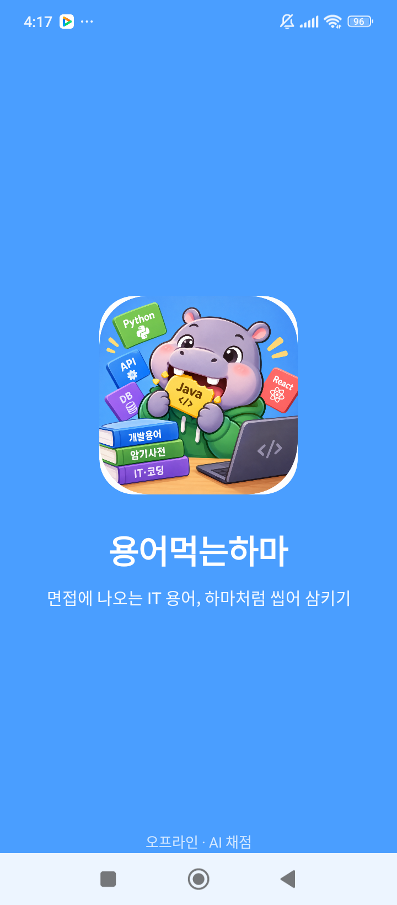
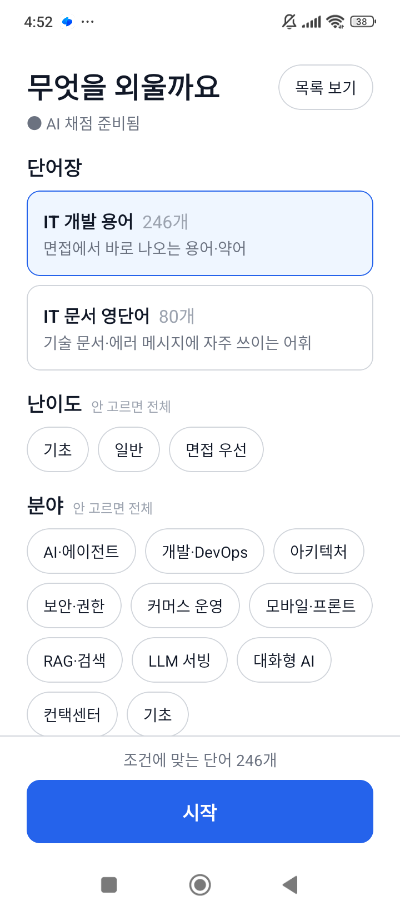
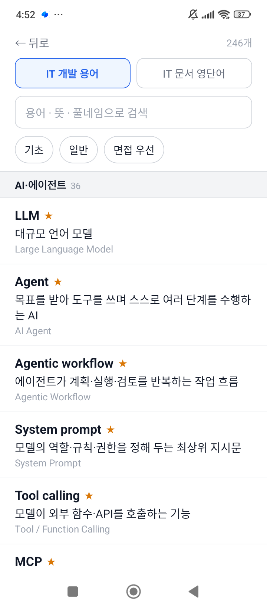
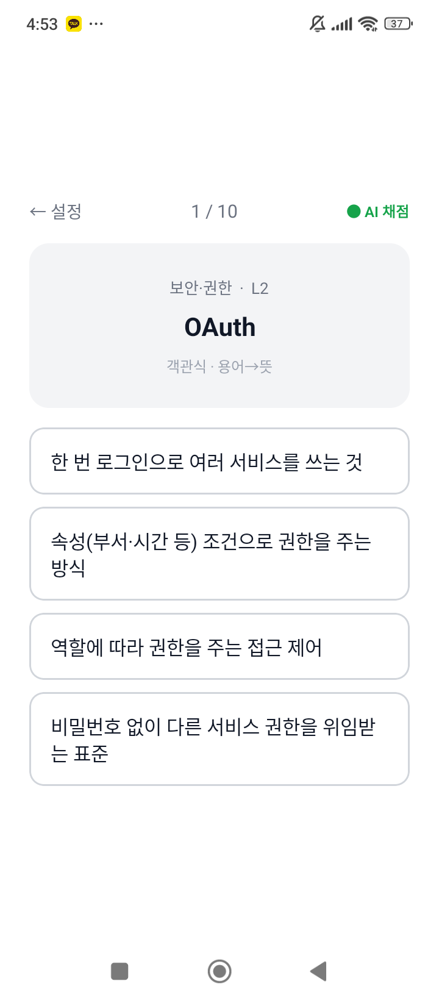
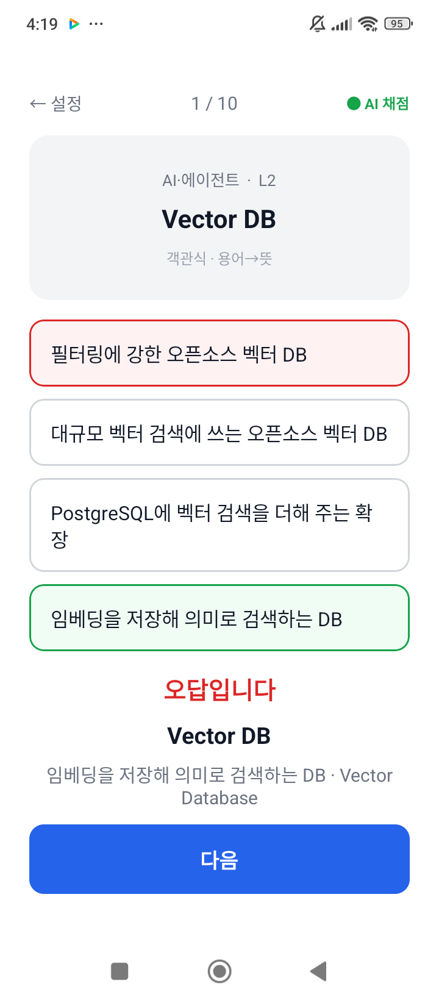
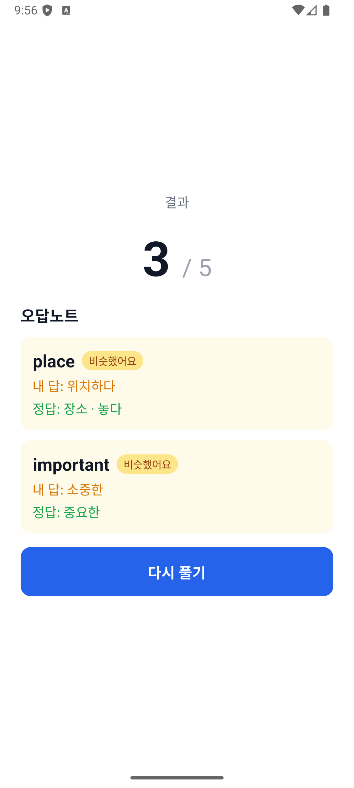
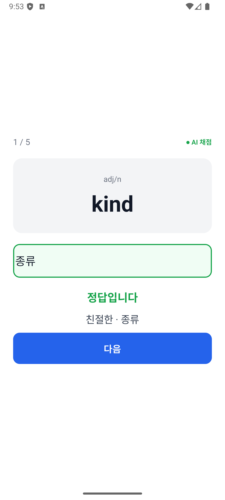
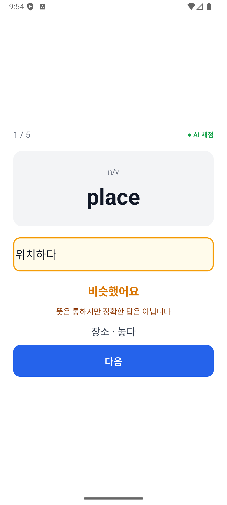
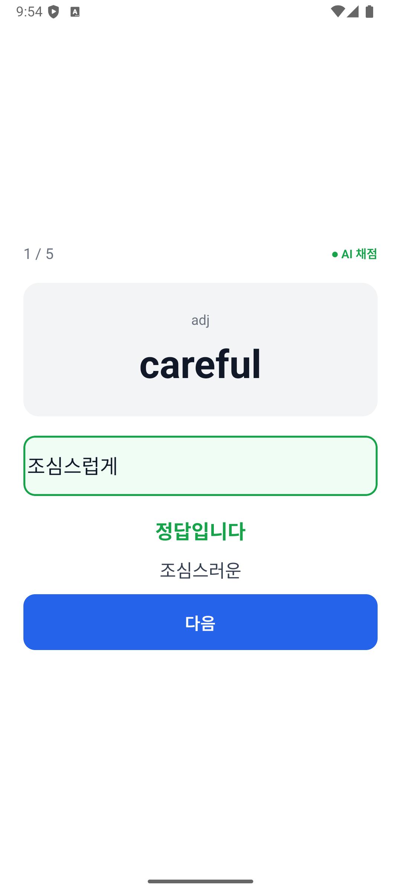

# 용어먹는하마 — 온디바이스 AI 채점 IT 용어 앱

뜻을 **직접 입력**하고, **복수정답**을 인정하고, 애매한 답은 "비슷했어요"로 알려주는
오프라인 암기 앱.

한국어 의미 판정을 위해 **임베딩 모델을 기기에 탑재**했다.
서버도, 로그인도, 네트워크 연결도 필요 없다.

React Native (Expo prebuild) · TypeScript · ONNX Runtime

> 이름은 단기기억을 관장하는 **해마**(hippocampus)에서 Hippo 를 따왔다.
> IT 용어를 먹어 치우는 하마라는 뜻이다.

---

## 화면

| 런칭 | 시작 — 범위를 고른다 | 목록 — 전체를 훑어본다 |
|---|---|---|
|  |  |  |
| 이 동안 임베딩 모델을 올린다.<br>그래서 시작 화면은 보통<br>**AI 채점 준비됨**으로 뜬다 | 단어장·난이도·분야·방식·문항 수.<br>조건에 맞는 개수가 아래에 계속 보인다 | 분야별로 묶이고 헤더가 고정된다.<br>★는 면접 우선 등급 |

| 객관식 — 헷갈리는 것끼리 묶어 낸다 | 채점 |
|---|---|
|  |  |
| `PII`의 오답 보기가 **인가·JWT·HITL**.<br>같은 분야에서 실제로 헷갈리는 용어들이다 | `Pub/Sub`의 오답 보기는<br>**Event-driven·Queue·Webhook**.<br>정답은 초록, 풀네임도 함께 보여준다 |

| 오답 | 결과 · 오답노트 |
|---|---|
|  |  |
| `Vector DB`의 보기가 전부 벡터 DB 설명이다.<br>내가 고른 것은 빨강, 정답은 초록 | 내가 **뭐라고 답했는지 그대로**.<br>정답과 나란히 둔다 |

### 주관식 채점 — 직접 입력했을 때

| 복수정답 인정 | "비슷했어요" | AI 활용형 판정 |
|---|---|---|
|  |  |  |
| `kind`의 두 번째 뜻<br>**"종류"**도 정답 | `place` → **"위치하다"**는<br>오답이되 통한다고 알려준다 | `careful` → **"조심스럽게"**.<br>규칙으로는 못 잡는다 (0.92) |

> 주관식은 **IT 문서 영단어** 덱에서만 쓴다. IT 용어 덱은 뜻이 서술형이라
> 받아쓰기가 성립하지 않아 객관식만 낸다 (위 '출제 방식' 참조).
> 기본 단어장은 **IT 개발 용어**다.

---

## 단어장

| 단어장 | 수록 | 구성 |
|---|---|---|
| **IT 개발 용어** | 301개 | AI·에이전트 / 개발·DevOps / 아키텍처 / 보안·권한 / 커머스 운영 /<br>모바일·프론트 / RAG·검색 / LLM 서빙 / 대화형 AI / 컨택센터 /<br>제조·스마트팩토리 / 물류 현장 / Vision AI / 기간계 연동 / SI·프로젝트 / 기초 |
| **IT 문서 영단어** | 80개 | 문서 읽기 / 에러·로그 / 리뷰·협업 / 릴리스·운영 |

용어는 한국어 뜻과 영문 풀네임을 함께 담는다. 둘 다 정답으로 인정한다.

```json
{
  "word": "RAG",
  "meanings": ["검색한 자료를 근거로 답을 생성하는 방식",
               "Retrieval-Augmented Generation"],
  "partOfSpeech": "AI·에이전트",
  "near": ["검색 증강 생성"],
  "level": 3,
  "aliases": ["RAG", "Retrieval-Augmented Generation"],
  "confusable": ["Fine-tuning", "Grounding", "Embedding"]
}
```

| 필드 | 쓰임 |
|---|---|
| `meanings` | 정답으로 인정할 뜻 (배열) |
| `near` | "비슷했어요"로 처리할 근접 오답 |
| `aliases` | 뜻→용어 방향에서 인정할 다른 표기 (`sLLM`, `경량 LLM`, …) |
| `confusable` | 객관식 오답 보기의 1순위 후보 — 헷갈리는 용어끼리 묶는다 |
| `level` | 1 기초 / 2 일반 / 3 면접 우선 |

JSON은 손으로 고치지 않는다. `data/build_it_terms.py`가 생성하며,
별칭 충돌·중복 뜻·헷갈림 묶음 누락을 생성 시점에 검사한다.

---

## 사용법

1. **단어장**을 고르고 **난이도·분야**로 범위를 좁힌다 (안 고르면 전체)
2. **출제 방식**을 고른다 — 덱이 지원하는 방식만 보인다
3. **문항 수**(10 / 20 / 30)를 고르고 시작
4. 보기에서 고르거나(객관식) 직접 입력한다(주관식)
   - 초록 **정답입니다**
   - 주황 **비슷했어요** — 뜻은 통하지만 정확하지 않음 (점수 없음)
   - 빨강 **오답입니다**
   - 모르면 **🤔 모르겠어요** — 찍지 말고 넘긴다. 내일 다시 나온다
5. 끝나면 **결과와 오답노트**가 나온다. 항목을 **터치하면 펼쳐진다**

> 주관식이 있는 덱에서는 우상단 **● AI 채점** 표시가 초록이면 모델이
> 준비된 상태다. 모델 로딩(약 2초)은 런칭 화면이 가려 주므로 보통은
> 준비된 채로 시작한다. 로딩이 늦어도 규칙 기반 채점으로 쓸 수 있다.

### 출제 방식 — 덱마다 다르다

| 방식 | 묻는 것 | IT 개발 용어 | IT 문서 영단어 |
|---|---|:---:|:---:|
| 객관식 · 용어→뜻 | 보기 4개 중 고르기 | ✅ | ✅ |
| 객관식 · 뜻→용어 | 보기 4개 중 고르기 | ✅ | ✅ |
| 주관식 · 용어→뜻 | `deprecated` → ? | — | ✅ |
| 주관식 · 뜻→용어 | `더 이상 권장되지 않는` → ? | — | ✅ |

**뜻→용어** 방향을 따로 둔 이유: 용어를 보면 아는데 막상 말로 설명할 때
떠오르지 않는 경우가 있다. 양방향으로 물어야 실제로 외웠는지 확인된다.

**IT 용어 덱에 주관식이 없는 이유**는 뜻이 서술형 문장이라서다. 301개의
첫 번째 뜻이 중간값 22자, 15자 이상이 93%, 최대 40자다.

```
FDE → "고객 현장에 들어가 제품을 맞춰 붙이고 요구를 개발팀에 전달하는 엔지니어"
```

받아쓸 수 있는 길이가 아니다. 뜻을 **알아도** 자기 말로 짧게 쓰게 되고,
그러면 유사도가 정답선을 못 넘어 오답이 된다 — 아는데 틀리는 구조다.
영단어 덱은 뜻이 짧고(10자 이하가 56%) 80개 전부 유의어를 들고 있어서
표현이 달라도 데이터로 잡힌다. 그래서 거기서는 주관식을 유지한다.
([#9](https://github.com/reddol18/dev_keyword_test/issues/9))

### 목록 보기

시작 화면 우상단에서 전체 용어를 훑어볼 수 있다.
분야별로 묶여 있고 헤더가 상단에 고정되며, 검색은 용어·뜻·별칭·근접어를
모두 훑는다. ★는 면접 우선 등급이다.

### 잊을 때쯤 다시 나온다 — 간격 반복

단어마다 **다음에 보여줄 날짜**를 들고 있다. 맞히면 간격이 길어지고 틀리면 하루로 돌아간다.

```
맞힘        streak +1,  간격 = 1 · 3 · 7 · 14 · 30 · 60일 (streak 번째)
비슷했어요   streak  0,  간격 = 2일
틀림        streak  0,  간격 = 1일
```

출제 순서는 이렇다.

| 순위 | 대상 |
|---|---|
| 1 | **오늘 틀린 것** — 바로 다시 본다 |
| 2 | **복습할 때가 된 것** — 밀린 것부터 |
| 3 | **처음 보는 것** |
| 4 | 나머지 |

**처음 보는 단어 자리를 매 회차 2개 떼어 둔다.** 우선순위만 따르면 복습이 자리를
다 차지해서, 301개 덱을 하루 10문제로 90일 돌려도 23%(69개)밖에 못 본다.
두 자리를 비워 두면 63%(191개)가 된다. 면접 대비라 덱을 한 바퀴 도는 것도 중요하다.

오늘 **맞힌** 단어는 그날 다시 나오지 않는다. 다만 **틀린** 단어는 같은 날에도
다시 나온다 — 오답을 바로 복습하는 흐름이 끊기지 않게.

기록은 기기에만 남는다(`AsyncStorage`, 키 `srs-v1`).

---

## 왜 만들었나

기존 단어장 앱 리뷰를 읽고 시작했다. 학생들의 불만이 구체적이었다.

- "영단어만 보고 **뜻 직접 쓰는 것**도 있었으면"
- "문제들이 다 순서대로 나와요 **랜덤으로** 나왔으면"
- "**복수정답도 되게** 좀 해주세요 … 진짜 스트레스 받아요"
- "단어쓰기 할때 **대문자로 계속 시작해서** 불편해요"
- "**인터넷 연결없이도** 학습할 수 있으면"

객관식이 아니라 직접 입력, 그리고 **맞는 답을 틀렸다고 하지 않는 것**이 핵심이었다.

---

## 채점이 어떻게 동작하나

한국어 뜻 채점은 생각보다 까다롭다. "여행하다"를 정답으로 두면
학생이 쓴 "여행가다"는? "조심스러운"에 대해 "조심스럽게"는?

### 3단계 판정

```
정답        점수 O   초록
비슷했어요   점수 X   주황  ← 뜻은 통하지만 정확하지 않음
오답        점수 X   빨강
```

### 판정 순서

규칙과 모델을 **조합**한다. 어느 하나만으로는 부족했다.

**1. 어간 일치 → 정답**

어미를 떼고 비교한다. `여행하다` `여행가다` `여행` → 모두 `여행`.

모델보다 이쪽이 확실한 경우가 있다. `연습하다`↔`연습`을 모델은 0.45로
떨어뜨리지만 같은 말이다.

**2. 유의어 목록 → 비슷했어요**

데이터에 명시한 근접 오답. `place`의 `near: ["위치하다", "두다", ...]`.

모델이 `위치하다`↔`두다`를 0.33으로 보기 때문에 이것도 필요하다.

**3. 임베딩 유사도**

위에서 안 걸리면 모델이 판정한다.

```
유사도 ≥ 0.85  →  정답
유사도 ≥ 0.70  →  비슷했어요
그 미만        →  오답
```

### 임계값을 0.85로 높게 잡은 이유

실측해보니 **이 모델은 반의어를 잘 구분하지 못한다.**

```
기억하다 ↔ 잊다       0.6520   ← 반대말인데 높다
빌려주다 ↔ 빌리다     0.6966   ← 반대말인데 높다
어려운   ↔ 쉬운       0.6005
연습하다 ↔ 연습       0.4470   ← 같은 말인데 낮다
위치하다 ↔ 두다       0.3321   ← 유의어인데 낮다
```

임베딩 모델의 알려진 한계다. 반의어는 같은 문맥에 등장하므로 벡터가 가깝다.

그래서 **모델은 활용형 판정에만 쓰고**(거기선 확실히 강하다), 나머지는
규칙과 데이터에 맡겼다.

```
조심스럽게 ↔ 조심스러운   0.9224   ← 규칙으로는 못 잡던 것
친절한     ↔ 친절하다     0.9232
여행가다   ↔ 여행하다     0.8798
```

### 용어는 표기를 느슨하게 본다

IT 용어는 띄어쓰기·하이픈 표기가 제각각이다. 뜻→용어 방향에서는
`[\s\-_/.]`를 모두 떼고 비교한다. `Pub/Sub` `PubSub` `pub sub`이 같게 취급된다.

### 객관식 오답 보기는 어떻게 고르나

우선순위대로 고른다.

1. `confusable`에 묶인 용어 — `Hybrid search` ↔ `BM25` ↔ `Reranker`
2. 같은 분야에서 글자가 비슷한 것
3. 같은 난이도
4. 무작위

**정답과 겹치는 보기는 반드시 걸러낸다.** 보기 후보가 정답의
`meanings`·`aliases`·`near` 중 무엇과도 겹치면 제외한다. 안 그러면
"정답이 2개인" 문제가 나온다.

여기서는 임베딩을 쓰지 않는다. 문제마다 모델을 돌리면 수십 ms가 더 붙는데,
오답 보기는 "그럴듯하면" 충분해서 글자 유사도(자소 Jaccard)로 족하다.

---

## 왜 온디바이스인가

리뷰에 "인터넷 연결 없이도 학습하고 싶다"가 있었다. 그리고

- **서버 비용 0** — 유지비가 들지 않는다
- **응답 40~80ms** — API 왕복보다 빠르다
- **개인정보 없음** — 입력이 기기 밖으로 나가지 않는다

### 실측 (Redmi Note 14 Pro, arm64)

| 항목 | 값 |
|---|---|
| 모델 로딩 | 2.1초 (앱 시작 시 1회) |
| 추론 | 40~80ms / 문항 |
| 모델 크기 | 106MB (int8 양자화) · APK 안에서는 86.9MB |

폰에서 나온 유사도 값이 PC에서 파이썬으로 계산한 값과
**소수점 4자리까지 일치**했다. int8 양자화가 ARM에서 정확히 동작한다는 뜻이다.

---

## 기술 스택

| 영역 | 선택 | 비고 |
|---|---|---|
| 프레임워크 | React Native 0.86 (Expo 57 prebuild) | 네이티브 모듈을 쓰려고 prebuild |
| 언어 | TypeScript | strict |
| 추론 | `onnxruntime-react-native` 1.24.3 | JSI 기반, 기기 CPU |
| 모델 | [`jhgan/ko-sroberta-multitask`](https://huggingface.co/jhgan/ko-sroberta-multitask) | 한국어 SBERT, int8 |
| 토크나이저 | `@huggingface/tokenizers` | 순수 JS, 97KB |
| 저장 | 로컬 JSON + `AsyncStorage` | 백엔드 없음 |

---

## 실행 방법

### 준비

```sh
npm install                  # postinstall이 onnxruntime 패치를 적용한다
./scripts-fetch-model.sh     # 모델 106MB 다운로드 (저장소에 없음)
npx expo prebuild --platform android
```

`android/`는 저장소에 두지 않는다. `prebuild`로 생성하면
`scripts-postinstall.js`가 적용한 패치가 그대로 반영된다.

### 개발 모드

```sh
npx expo start --dev-client
```

별도 터미널에서:
```sh
npm run android
```

### 단독 실행 APK

```sh
cd android && ./gradlew assembleRelease
adb install android/app/build/outputs/apk/release/app-release.apk
```

JS 번들과 모델이 APK에 포함되어 **네트워크 없이 단독 실행**된다. 181MB.

ARM 기기용으로만 빌드한다 (`arm64-v8a`, `armeabi-v7a`). x86 계열을 넣으면
106.8MB 가 더 붙는데 실기기에서 쓰이지 않는다. 설정은 `app.json` 의
`expo-build-properties` → `buildArchs` 에 있다 — `android/gradle.properties`
를 직접 고치면 `expo prebuild` 가 덮어쓴다.

> 개발 빌드(`assembleDebug`)는 Metro 서버가 있어야 실행된다.
> 오프라인 동작을 확인하려면 release로 빌드할 것.

---

## 프로젝트 구조

```
src/
  SplashScreen.tsx  런칭 화면 (네이티브 스플래시 뒤를 이어받는다)
  StartScreen.tsx   단어장·난이도·분야·방식·문항 수 선택
  QuizScreen.tsx    시험 화면
  ResultScreen.tsx  결과 · 오답노트
  ListScreen.tsx    전체 목록 훑어보기 · 검색
  quiz.ts           출제 (간격 반복 순서)
  choices.ts        객관식 오답 보기 생성
  grading.ts        3단계 채점 (어간 → 유의어 → 모델)
  srs.ts            간격 반복 — 다음에 볼 날짜 (AsyncStorage)
  decks.ts          단어장 정의 · 필터
  embedding.ts      ONNX 추론 · 토크나이저 · 코사인 유사도
  theme.ts          공통 스타일
  types.ts          Word, Grade, QuizMode, Question, Answer
data/
  it_terms.json     IT 개발 용어 301개   ← build_it_terms.py 가 생성
  it_words.json     IT 문서 영단어 80개  ← build_it_words.py 가 생성
  quiz_cli.mjs      채점·출제 로직 CLI 점검용
assets/model/
  model.onnx        임베딩 모델 (git 제외, 스크립트로 받음)
  tokenizer.json
```

---

## 빌드 중 만난 문제

`onnxruntime-react-native`를 Expo prebuild 환경에 붙일 때 두 가지에 막혔다.
둘 다 `scripts-postinstall.js`에서 자동 처리한다.

### 1. `unimodule.json` — 조용히 실패하는 자동링킹

패키지에 `unimodule.json`이 들어 있어 `expo-modules-autolinking`이
**Expo 모듈로 오인**한다. 그래서 RN 커뮤니티 자동링킹에서 제외되는데,
실제로는 Expo 모듈이 아니라 **어느 쪽에도 등록되지 않는다.**

빌드는 성공한다. 실행하면 `Cannot read property 'install' of null`로 죽는다.
빌드 로그에 아무 단서가 없다.

파일을 지우면 정상 등록된다.
([관련 이슈](https://github.com/microsoft/onnxruntime/issues/29004))

### 2. 단어만 고치면 APK 에 반영되지 않는다

`data/*.json` 만 고치고 빌드하면 **`BUILD SUCCESSFUL` 이 떠도 APK 안에는
옛 단어가 그대로 들어간다.** Gradle 이 이 JSON 을 JS 번들 태스크의 입력으로
추적하지 않아 "변경 없음"으로 보고 번들 생성을 건너뛰기 때문이다.

빌드가 비정상적으로 빨리 끝나면(1분 내외) 이것을 의심할 것. 확인은
APK 안의 번들을 직접 열어 보는 게 확실하다.

```sh
tar -xf app-release.apk assets/index.android.bundle
grep -c "새로 넣은 용어" assets/index.android.bundle
```

번들을 강제로 다시 만들면 해결된다.

```sh
./gradlew createBundleReleaseJsAndAssets --rerun-tasks
./gradlew assembleRelease
```

### 3. `VersionNumber` — Gradle 9에서 제거된 API

`build.gradle`이 `org.gradle.util.VersionNumber`를 쓰는데 Gradle 9에서 빠졌다.
RN 0.71 미만에서만 쓰이는 분기라 문자열 비교로 교체했다.

---

## 알려진 한계

각 항목은 이슈로 열어 두었다.

- **APK 181MB** — x86 계열을 빼서 288MB 에서 줄였다
  ([#1](https://github.com/reddol18/dev_keyword_test/issues/1), 닫음).
  남은 181MB 의 절반은 모델 한 장(86.9MB)이다. 파라미터 110M × int8 = 105MB
  라 **이 모델로는 하한**이고, 더 줄이려면 층이 적은 모델로 바꿔야 한다
  (ALBERT 계열이면 약 11MB → APK 105MB). 다만 채점 임계값 0.85 를 다시
  잡아야 해서 용량 작업이 아니라 채점 모델 교체 작업이 된다
  → [#8](https://github.com/reddol18/dev_keyword_test/issues/8)
- **반의어 구분 불가** — 임베딩 모델 전반의 한계다. 임계값 0.85가 이걸 전제로 잡힌
  값이라 낮추면 안 된다. 다만 IT 용어는 뜻이 서술형이라 실측상 오채점은 없었다
  ([측정 결과](https://github.com/reddol18/dev_keyword_test/issues/3#issuecomment-6332184571))
- **Android만 확인** — iOS는 빌드해보지 않았다
  → [#4](https://github.com/reddol18/dev_keyword_test/issues/4)

---

## 라이선스

MIT

모델 [`jhgan/ko-sroberta-multitask`](https://huggingface.co/jhgan/ko-sroberta-multitask)는
별도 라이선스를 따른다.
